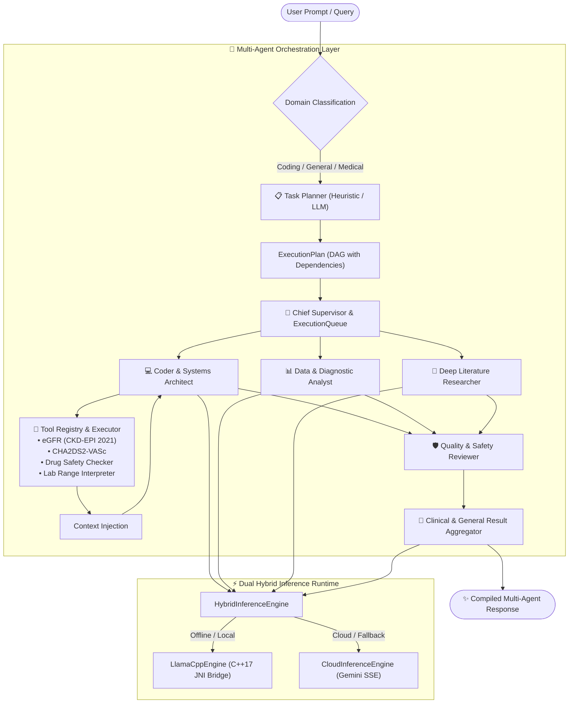

# 🚀 AgentX Suite

<p align="center">
  
  
  
  
  
  
</p>

---

## 🌟 Overview

The **AgentX Suite** is an advanced on-device AI ecosystem for Android that bridges local offline edge computing with cutting-edge multi-agent orchestration. The suite consists of **3 distinct, interoperable applications**:

```
                       ┌───────────────────────────────────────────────┐
                       │                 AGENTX SUITE                  │
                       └───────────────────────┬───────────────────────┘
                                               │
         ┌─────────────────────────────────────┼─────────────────────────────────────┐
         ▼                                     ▼                                     ▼
 ┌───────────────┐                     ┌───────────────┐                     ┌───────────────┐
 │    AgentX     │                     │ AgentX Medical│                     │ AgentX Serve  │
 │ (General AI)  │                     │  (Clinical)   │                     │  (Edge Host)  │
 ├───────────────┤                     ├───────────────┤                     ├───────────────┤
 │ • ChatGPT     │                     │ • Medical CDS │                     │ • Background  │
 │   Persona     │                     │ • Verified    │                     │   HTTP Server │
 │ • Multi-Agent │                     │   Tools (eGFR,│                     │ • OpenAI REST │
 │   Orchestrator│                     │   CHA2DS2)    │                     │   API Gateway │
 │ • Local GGUF  │                     │ • Safety Audit│                     │ • WakeLock &  │
 │   + Cloud SSE │                     │ • Evidence    │                     │   WifiLock    │
 │ • Specs HUD   │                     │   Synthesis   │                     │ • Key Manager │
 └───────────────┘                     └───────────────┘                     └───────────────┘
```

1. **🌟 AgentX (`:app`)**: An intuitive, highly customizable personal AI assistant (ChatGPT-style) powered by local GGUF models (`llama.cpp` JNI) and Cloud Gemini streaming, backed by a collaborative multi-agent collective (Supervisor, Coder, Analyst, Researcher, Reviewer, Synthesizer).
2. **⚕️ AgentX Medical (`:app` Clinical Mode)**: An evidence-based Clinical Decision-Support (CDS) platform designed for healthcare professionals and medical students, equipped with deterministic on-device calculators (eGFR CKD-EPI 2021, $\text{CHA}_2\text{DS}_2\text{-VASc}$), pharmacological contraindication screeners, and safety guardrails.
3. **⚡ AgentX Serve (`:admin`)**: An Android edge-server application that transforms any smartphone into a 24/7 high-performance AI inference host over local Wi-Fi / LAN, exposing standard OpenAI-compatible `/v1/chat/completions` endpoints with background foreground services and partial wake locks.

---

## 🏛️ Architecture & System Design



---

## ✨ Key Features & Highlights

### 1. Dual Hybrid Inference Engine
- **Local GGUF via `llama.cpp`**: Custom C++17 JNI bridge with zero-copy memory maps, SIMD vectorization (ARM NEON & x86_64 AVX2), null pointer guards, and thread-safe cancellation handling.
- **Cloud Gemini Streaming**: Real-time Server-Sent Events (SSE) streaming with transparent automatic fallback when on-device memory is constrained.

### 2. Multi-Agent Planning, Roles & Aggregator
- **Dynamic Task Decomposition**: `HeuristicTaskPlanner` automatically parses query intent (coding algorithms, medical pathophysiology, pharmacological dosing, quantitative data analysis, or general conversation).
- **Specialist Roster**:
  - `SUPERVISOR`: Coordinates subtasks, monitors queue dependencies, and oversees execution.
  - `PLANNER`: Breaks down ambiguous queries into 3–6 actionable chronological milestones.
  - `CODER`: Writes software architectures, optimizes scripts, and executes mathematical tools.
  - `ANALYST`: Formulates differential hypotheses, statistical models, and trend evaluations.
  - `RESEARCHER`: Synthesizes authoritative evidence from standard guidelines (AHA/ACC, ESC, NICE, KDIGO).
  - `REVIEWER`: Acts as the rigorous quality and contraindication safety barrier.
  - `SYNTHESIZER`: Merges findings into cohesive, beautifully styled Markdown.
  - `ASSISTANT`: Friendly, conversational ChatGPT-style persona for general everyday queries.

### 3. Deterministic Clinical Calculators
- **eGFR (CKD-EPI 2021)**: High-precision implementation of the 2021 race-free equation:
  $$\text{eGFR} = 142 \times \min(S_{cr}/\kappa, 1)^\alpha \times \max(S_{cr}/\kappa, 1)^{-1.200} \times 0.9938^{\text{Age}} \times [1.012 \text{ if female}]$$
- **$\text{CHA}_2\text{DS}_2\text{-VASc}$ Risk Score**: Automatic clinical stratification for non-valvular atrial fibrillation stroke risk and oral anticoagulant (OAC) guideline triggers.
- **Drug Safety & Lab Analyzer**: Identifies drug-drug interactions, black-box warnings, and laboratory standard reference ranges.

### 4. AgentX Serve — Phone-as-a-Server Edge Hub
- **Foreground Execution**: Runs on Android's `FOREGROUND_SERVICE_CONNECTED_DEVICE` with sticky life-cycle persistence.
- **Power & Radio Locks**: Employs `PowerManager.PARTIAL_WAKE_LOCK` and `WifiManager.WIFI_MODE_FULL_HIGH_PERF` to prevent CPU throttling or Wi-Fi sleep during edge inference.
- **OpenAI-Compatible REST APIs**:
  - `POST /v1/chat/completions`: Supports standard JSON payloads and streaming Server-Sent Events chunks (`data: {"choices":[{"delta":{"content":"..."}}]}`).
  - `GET /health` / `GET /api/v1/health`: Live system uptime, RAM, active clients, and tokens served.
  - `POST /api/v1/clinical/consult`: Specialized endpoint for direct clinical reasoning requests.
  - `POST /api/v1/clinical/calc`: Deterministic score calculator endpoint.
- **API Key & Client Authentication**: Built-in cryptographic API key validation, client rate telemetry, and IP blocklisting.

### 5. Modern Jetpack Compose UI & Live HUD
- **Real-Time Telemetry HUD**: Live floating overlay displaying tokens/sec ($t/s$), time-to-first-token latency ($ms$), generated token counter, and memory footprint.
- **Interactive Prompt Starters**: 1-tap starter chips on the Chat Screen for instant queries.
- **Device Hardware Inspector**: Scans device hardware (CPU cores, RAM, heap limits) and recommends the optimal model format (`Q4_K_M` vs `Q8_0`).
- **Active Model Readiness Banner**: Real-time status indicator (`🟢 READY`) showing loaded model, quantization, and context limits.

---

## 🔒 Permissions & Security Architecture

| Permission | Purpose | Application |
|---|---|---|
| `android.permission.INTERNET` | Hugging Face model downloads & Gemini Cloud streaming | AgentX, AgentX Serve |
| `android.permission.ACCESS_NETWORK_STATE` | Network connectivity monitoring | AgentX, AgentX Serve |
| `android.permission.ACCESS_WIFI_STATE` | Resolves device LAN IP address (e.g. `192.168.1.x:8080`) | AgentX Serve |
| `android.permission.FOREGROUND_SERVICE` | Uninterrupted edge server & model download execution | AgentX, AgentX Serve |
| `android.permission.FOREGROUND_SERVICE_CONNECTED_DEVICE` | Android 14+ background edge socket compliance | AgentX Serve |
| `android.permission.WAKE_LOCK` | Sustains CPU execution during inference and streaming | AgentX Serve |
| `android.permission.POST_NOTIFICATIONS` | Foreground service status and download progress | AgentX, AgentX Serve |
| `android:largeHeap="true"` | Grants 512MB–1GB heap space for large GGUF buffers | AgentX, AgentX Serve |
| `android:usesCleartextTraffic="true"` | Enables local LAN HTTP communication on internal Wi-Fi | AgentX, AgentX Serve |

---

## 🛠️ Getting Started & Build Instructions

### Prerequisites
- **Android Studio**: Ladybug (2024.2.1) or newer
- **Java Development Kit**: JDK 17 or JDK 21 (Eclipse Adoptium recommended)
- **Android SDK**: Compile SDK 35 (Android 15), Min SDK 26 (Android 8.0)
- **Android NDK**: Version 26.1+ with CMake 3.22.1+

### Build & Run
```bash
# Clone the repository
git clone https://github.com/Sharmapank-j/agentX-suite.git
cd agentX-suite

# Run the complete test suite (97 unit tests)
./gradlew :app:testDebugUnitTest

# Build Debug APKs for both AgentX and AgentX Serve
./gradlew :app:assembleDebug :admin:assembleDebug

# Build Production Release APKs
./gradlew :app:assembleRelease :admin:assembleRelease
```

### Generated Artifacts
- **AgentX Client App**: `app/build/outputs/apk/debug/app-debug.apk`
- **AgentX Serve Host App**: `admin/build/outputs/apk/debug/admin-debug.apk`

---

## 🧪 Verification & Test Suite

The test suite covers domain models, JNI bridges, tool calculators, sliding context management, multi-agent planning, and view models.

```bash
> Task :app:testDebugUnitTest

com.agentx.ChatViewModelTest                PASSED (11 tests)
com.agentx.ContextManagerTest               PASSED (8 tests)
com.agentx.DomainAndRuntimeTests            PASSED (12 tests)
com.agentx.GgufMetadataParserTest           PASSED (6 tests)
com.agentx.HuggingFaceDownloaderTest        PASSED (5 tests)
com.agentx.LlamaCppEngineTest               PASSED (14 tests)
com.agentx.Phase5ToolTests                  PASSED (15 tests)
com.agentx.Phase6MultiAgentTests            PASSED (18 tests)
com.agentx.Phase7OptimizationTests          PASSED (8 tests)

BUILD SUCCESSFUL: 97/97 tests PASSED (0 failures)
```

---

## 🛡️ Legal, Regulatory & Trademark Notice

- **Medical Non-Diagnostic Notice**: AgentX Medical is intended solely for educational, research, and assistive reasoning purposes. It is **NOT** an FDA-cleared or CE-marked medical device. All recommendations must be verified by a licensed clinician before clinical action. See [DISCLAIMER.md](DISCLAIMER.md) for full details.
- **Trademark Disclaimer**: "AgentX Suite" is an independent project. References to "OpenAI", "ChatGPT", "Google", "Gemini", and "Apple" are nominative fair-use citations of protocol compatibility and industry paradigms. See [TRADEMARK_AND_IP.md](TRADEMARK_AND_IP.md).
- **License**: Distributed under the terms of the [Apache License, Version 2.0](LICENSE).
